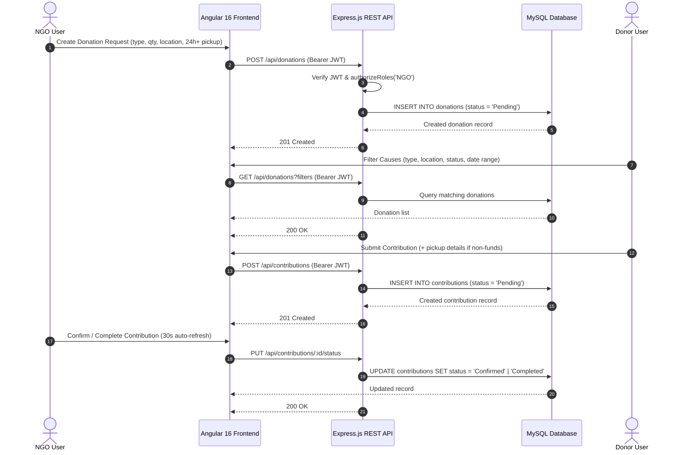
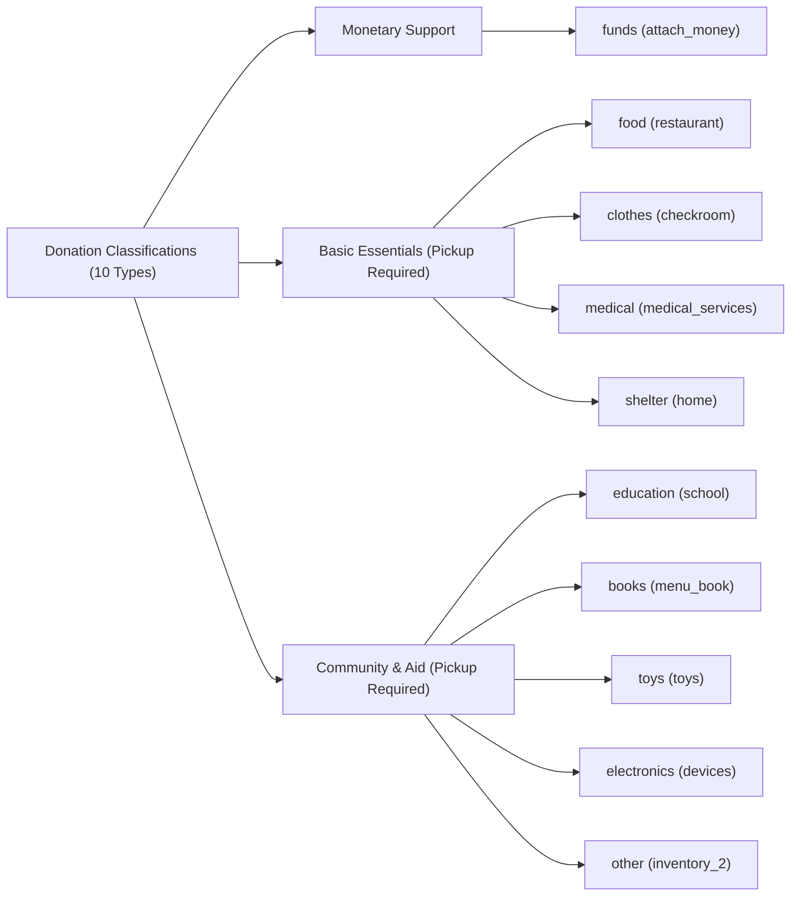
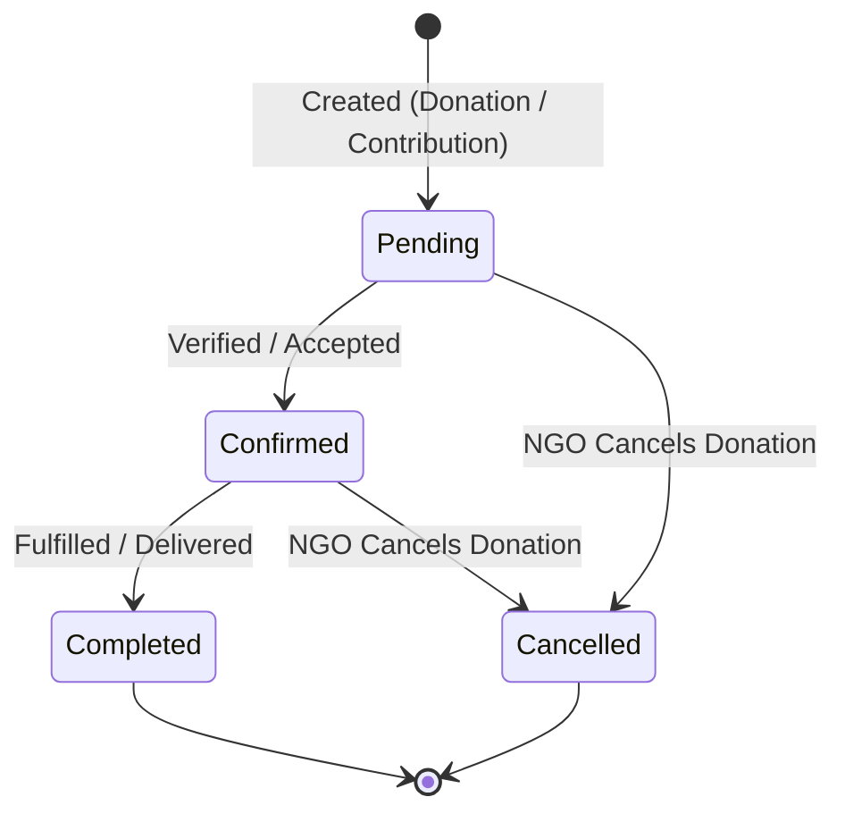
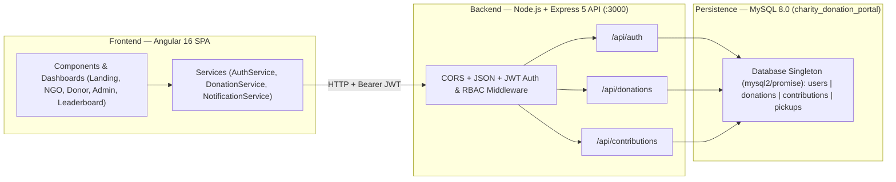
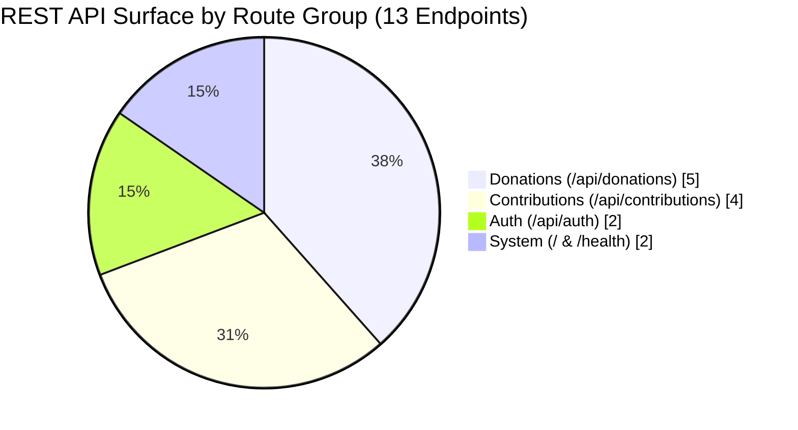
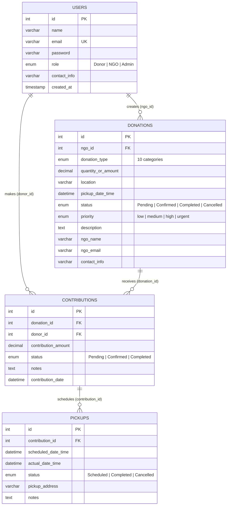

# GiveBit


A comprehensive full-stack web application designed to streamline charity donations and facilitate seamless contributions between NGOs and donors. The platform provides an intuitive interface for managing donation requests, tracking contributions, and fostering community engagement through real-time updates and gamification features.

## Key Features

### Platform Capabilities Overview

| Module | Core Capabilities | Primary Role(s) | Implementation Highlights |
| :--- | :--- | :--- | :--- |
| **Authentication & RBAC** | Account registration, login, JWT session tokens (7-day expiry), route protection, and role authorization | `Admin`, `NGO`, `Donor` | `authenticateToken`, `authorizeRoles`, `AuthService`, `AuthGuard` |
| **Donation Management** | Create, view, edit pending requests, cancel drives, and configure bank/QR payment details | `NGO` | `DonationDialogComponent`, `DonationCreateComponent`, `DonationEditComponent` |
| **Discovery & Filtering** | Browse causes and filter by donation type, location substring, status, date range, or NGO | `Donor`, `NGO`, `Admin` | `DonationListComponent`, `GET /api/donations` |
| **Contribution & Pickups** | Submit monetary or item pledges, attach notes, schedule pickup windows/addresses, and update fulfillment status | `Donor`, `NGO` | `ContributionComponent`, `pickups` table, `/api/contributions` |
| **Role-Based Dashboards** | Dedicated KPI stats, recent activity feeds, and 30-second auto-refresh polling | `NGO`, `Donor`, `Admin` | `NgoDashboardComponent`, `DonorDashboardComponent`, `AdminDashboardComponent` |
| **Gamification & Alerts** | Ranked contributor leaderboard with time-period selector and role-scoped in-app notifications | `Donor`, `NGO` | `LeaderboardComponent`, `NotificationService`, `NotificationDropdownComponent` |

### Role & Access Matrix

| Capability | `Donor` | `NGO` | `Admin` |
| :--- | :---: | :---: | :---: |
| Browse & Filter Donation Requests | Yes | Yes | Yes |
| View Donation Details | Yes | Yes | Yes |
| Create, Edit, & Cancel Donation Requests | — | Yes | Platform Oversight |
| Submit Contributions & Schedule Pickups | Yes | — | — |
| Update Contribution Fulfillment Status | — | Yes | Yes |
| Access Donor Dashboard & Leaderboard | Yes | Leaderboard | Full Overview |
| Access NGO / Admin Dashboards | — | NGO Dashboard | Admin Dashboard |

### End-to-End Platform Workflow



<details>
<summary><strong>Interactive Explorer: Frontend Route Map (13 Routes)</strong></summary>

| Route Path | Component | Guard | Intended Access |
| :--- | :--- | :--- | :--- |
| `/` | `LandingComponent` | Public | Landing page, platform highlights, CTAs |
| `/login` | `LoginComponent` | Public | User sign-in |
| `/register` | `RegisterComponent` | Public | Account creation (`Donor`, `NGO`, `Admin`) |
| `/donations` | `DonationListComponent` | `AuthGuard` | Filterable donation directory |
| `/donations/create` | `DonationCreateComponent` | `AuthGuard` | Create new donation request |
| `/donations/:id` | `DonationDetailsComponent` | `AuthGuard` | Detailed donation view & metadata |
| `/donations/:id/edit` | `DonationEditComponent` | `AuthGuard` | Edit pending donation request |
| `/donations/:id/contribute` | `ContributionComponent` | `AuthGuard` | Pledge contribution & pickup scheduling |
| `/ngo/dashboard` | `NgoDashboardComponent` | `AuthGuard` | NGO listings, stats & received pledges |
| `/donor/dashboard` | `DonorDashboardComponent` | `AuthGuard` | Donor stats & contribution history |
| `/admin/dashboard` | `AdminDashboardComponent` | `AuthGuard` | Admin platform monitoring & metrics |
| `/leaderboard` | `LeaderboardComponent` | `AuthGuard` | Ranked donor leaderboard & period filter |
| `/profile` | `ProfileComponent` | `AuthGuard` | User profile & activity summary |

</details>

> [!NOTE]
> In the current development configuration, `AuthGuard` temporarily permits route access for UI testing, and frontend services (`AuthService`, `DonationService`) provide local mock fallbacks when the backend API is unreachable or returns empty datasets.

---

## Classifications & Lifecycle

### Donation Type Taxonomy

GiveBit classifies charitable requests into **10 structured categories** across monetary support and physical/in-kind fulfillment:



| Category (`donation_type`) | Fulfillment Mode | Pickup Required | Material Icon | Typical Use Case |
| :--- | :--- | :---: | :--- | :--- |
| `funds` | Monetary (Bank / QR) | No | `attach_money` | Emergency relief funds, operational grants |
| `food` | In-Kind Goods | Yes | `restaurant` | Community kitchens, packaged meals, groceries |
| `clothes` | In-Kind Goods | Yes | `checkroom` | Seasonal apparel, blankets, shelter clothing |
| `medical` | In-Kind Supplies | Yes | `medical_services` | First-aid kits, medicines, clinic equipment |
| `shelter` | In-Kind / Housing | Yes | `home` | Tents, bedding, temporary housing supplies |
| `education` | Academic Support | Yes | `school` | School kits, learning materials, classroom aid |
| `books` | In-Kind Goods | Yes | `menu_book` | Textbooks, storybooks, library donations |
| `toys` | In-Kind Goods | Yes | `toys` | Children's toys and recreational kits |
| `electronics` | In-Kind Hardware | Yes | `devices` | Laptops, tablets, assistive devices |
| `other` | Custom Goods/Services | Yes | `inventory_2` | General charitable items not listed above |

### Priority Classification

| Priority Level | UI Theme Color | Material Icon | Operational Meaning |
| :--- | :--- | :--- | :--- |
| `urgent` | `warn` (Red) | `priority_high` | Immediate emergency or time-critical relief |
| `high` | `accent` (Pink/Amber) | `arrow_upward` | High-need campaign requiring rapid fulfillment |
| `medium` | `primary` (Indigo) | `remove` | Standard scheduled drive (default priority) |
| `low` | Default | `arrow_downward` | Ongoing or flexible-timeline support |

### Entity Status Matrix & State Flow

| Entity | Allowed Status Values | Default State | Lifecycle Notes |
| :--- | :--- | :--- | :--- |
| **Donations** | `Pending`, `Confirmed`, `Completed`, `Cancelled` | `Pending` | Only `Pending` requests can be edited in the NGO UI; `DELETE` sets status to `Cancelled` |
| **Contributions** | `Pending`, `Confirmed`, `Completed` | `Pending` | Blocked when parent donation is `Cancelled`; updated via `PUT /api/contributions/:id/status` |
| **Pickups** | `Scheduled`, `Completed`, `Cancelled` | `Scheduled` | Linked to non-monetary (`donation_type !== 'funds'`) physical contributions |



---

## System Architecture

GiveBit follows a decoupled three-tier client-server architecture with a singleton MySQL database connector on the backend and reactive RxJS services on the frontend.



<details>
<summary><strong>Interactive Explorer: Repository Directory Structure</strong></summary>

```text
Charity & Donation Management Portal/
├── LICENSE                         # MIT License
├── README.md                       # Project documentation
├── backend/
│   ├── .env.example                # Environment variable template
│   ├── package.json                # Backend dependencies & npm scripts
│   ├── tsconfig.json               # TypeScript compiler configuration
│   ├── setup-database.js           # Automated database & table setup script
│   ├── update-database.js          # Adds ngo_name, ngo_email, contact_info columns
│   ├── check-database.js           # Inspects tables and donations schema
│   ├── check-enum.js               # Inspects donation_type ENUM values
│   ├── fix-enum.js                 # Expands donation_type ENUM to all 10 categories
│   └── src/
│       ├── index.ts                # Express app bootstrap, CORS, route mounting, /health
│       ├── database.sql            # Core schema (users, donations, contributions, pickups)
│       ├── config/
│       │   ├── database.ts         # Singleton mysql2/promise connection wrapper
│       │   └── database.sql        # Extended schema with 10 donation types & sample rows
│       ├── middleware/
│       │   └── auth.ts             # authenticateToken & authorizeRoles middleware
│       └── routes/
│           ├── auth.ts             # /api/auth (register, login)
│           ├── donations.ts        # /api/donations (CRUD + filtering + 24h validation)
│           └── contributions.ts    # /api/contributions (create, query, status updates)
└── frontend/
    ├── angular.json                # Angular CLI workspace & build budgets
    ├── package.json                # Angular 16 dependencies & scripts
    └── src/
        ├── environments/           # environment.ts & environment.prod.ts
        ├── styles/                 # Custom Angular Material SCSS themes
        └── app/
            ├── app-routing.module.ts
            ├── app.module.ts
            ├── guards/             # AuthGuard
            ├── models/             # Donation, Contribution, User TypeScript interfaces
            ├── services/           # AuthService, DonationService, NotificationService
            └── components/         # Landing, Login, Register, Dashboards, Donations, Leaderboard, Profile
```

</details>

---

## Technology Stack

### Frontend Technologies


| Technology | Version | Purpose |
| :--- | :--- | :--- |
| **Angular** | `^16.2.0` | Modular SPA framework with component-based architecture and routing |
| **Angular Material & CDK** | `^16.2.14` | Material Design UI components (cards, dialogs, tables, snackbars, chips, icons) |
| **TypeScript** | `~5.1.3` | Strongly typed models (`Donation`, `Contribution`, `User`) and services |
| **RxJS** | `~7.8.0` | Reactive state streams (`BehaviorSubject`), API pipelines, and 30s polling |
| **Karma & Jasmine** | `~6.4.0` / `~4.6.0` | Unit testing runner and assertion suite for Angular components/services |

### Backend Technologies


| Technology | Version | Purpose |
| :--- | :--- | :--- |
| **Node.js** | `v16+` | Server-side JavaScript runtime environment |
| **Express.js** | `^5.2.1` | REST API routing, request parsing, and middleware orchestration |
| **TypeScript** | `^5.9.3` | Type-safe backend compilation targeting ES2020 CommonJS (`dist/`) |
| **MySQL & `mysql2`** | `8.0` / `^3.16.0` | Relational persistence with promise-based parameterized queries |
| **JSON Web Token (`jsonwebtoken`)** | `^9.0.3` | Stateless JWT issuance and verification (`7d` default expiry) |
| **`bcryptjs`** | `^3.0.3` | Password hashing utility library |
| **`cors` & `dotenv`** | `^2.8.5` / `^17.2.3` | Cross-origin resource sharing and `.env` configuration loading |

---

## Getting Started

### Prerequisites

| Tool | Required Version | Purpose | Reference |
| :--- | :--- | :--- | :--- |
| **Node.js & npm** | `v16+` | Runtime and package management | [nodejs.org](https://nodejs.org/) |
| **MySQL Server** | `v8.0` recommended | Relational database storage | [mysql.com](https://www.mysql.com/) |
| **Angular CLI** | `v16.x` (`npm install -g @angular/cli`) | Serving and building the Angular SPA | [angular.io](https://angular.io/cli) |
| **Git** | Latest | Source control | [git-scm.com](https://git-scm.com/) |

### 1. Clone the Repository

```bash
git clone https://github.com/madhanmohanreddyperam06/Donation-and-Charity-Management-Portal.git
cd "Charity & Donation Management Portal"
```

### 2. Backend Setup

1. **Install dependencies:**

```bash
cd backend
npm install
```

2. **Create `.env` in `backend/`** (using `backend/.env.example` as a guide):

| Variable | Default / Fallback | Description |
| :--- | :--- | :--- |
| `DB_HOST` | `localhost` | MySQL server hostname |
| `DB_USER` | `root` | MySQL username |
| `DB_PASSWORD` | `""` | Your MySQL password |
| `DB_NAME` | `charity_donation_portal` | Target database name |
| `DB_PORT` | `3306` | MySQL port |
| `PORT` | `3000` | Express API listening port |
| `JWT_SECRET` | `fallback_secret` | Secret key used to sign/verify JWTs |
| `JWT_EXPIRES_IN` | `7d` | Token expiration reference |

```env
DB_HOST=localhost
DB_USER=root
DB_PASSWORD=your_mysql_password
DB_NAME=charity_donation_portal
DB_PORT=3306
PORT=3000
JWT_SECRET=your_jwt_secret_key_here
JWT_EXPIRES_IN=7d
```

> [!IMPORTANT]
> `backend/.env.example` lists `DB_NAME=charity_portal`, whereas `backend/src/config/database.ts` and the maintenance scripts default to `charity_donation_portal`. Set `DB_NAME=charity_donation_portal` in your `.env` so the API and helper scripts target the same database.

3. **Initialize the database:**

```sql
CREATE DATABASE IF NOT EXISTS charity_donation_portal;
```

```bash
mysql -u root -p charity_donation_portal < src/config/database.sql
```

<details>
<summary><strong>Interactive Guide: Database Migration & Diagnostic Scripts</strong></summary>

If you initialize using `src/database.sql` (which includes the `pickups` table and indexes, but only 4 initial `donation_type` enum values) instead of `src/config/database.sql`, run the bundled Node helper scripts from `backend/`:

| Script | Purpose | Command |
| :--- | :--- | :--- |
| `setup-database.js` | Creates `charity_donation_portal` and executes `src/database.sql` | `node setup-database.js` |
| `update-database.js` | Adds `ngo_name`, `ngo_email`, and `contact_info` columns to `donations` | `node update-database.js` |
| `fix-enum.js` | Expands `donations.donation_type` ENUM to all 10 categories | `node fix-enum.js` |
| `check-enum.js` | Verifies active `donation_type` ENUM values in `INFORMATION_SCHEMA` | `node check-enum.js` |
| `check-database.js` | Lists tables and inspects `donations` column structure | `node check-database.js` |

</details>

4. **Build and start the backend server:**

```bash
npm run build
npm start
```

### 3. Frontend Setup

```bash
cd ../frontend
npm install
npm start
```

> [!TIP]
> `frontend/src/environments/environment.ts` points `apiUrl` to `http://localhost:3000/api` (and `frontendUrl` to `http://localhost:4201`). Run `npx ng serve --port 4201` if you want the dev server on port `4201`, or `npm start` for the default Angular port `4200`.

---

## API Reference

All protected routes require an `Authorization: Bearer <token>` header.



### Endpoint Directory

| Group | Method | Endpoint | Access | Description |
| :--- | :---: | :--- | :--- | :--- |
| **System** | `GET` | `/` | Public | Returns API welcome banner JSON |
| **System** | `GET` | `/health` | Public | Returns `{ status: "OK", timestamp }` |
| **Auth** | `POST` | `/api/auth/register` | Public | Registers user (`name`, `email`, `password`, `role`) and returns JWT |
| **Auth** | `POST` | `/api/auth/login` | Public | Authenticates user and returns JWT + profile payload |
| **Donations** | `GET` | `/api/donations` | Authenticated | Lists donations sorted by `created_at DESC` with optional query filters |
| **Donations** | `GET` | `/api/donations/:id` | Authenticated | Retrieves a single donation request by ID |
| **Donations** | `POST` | `/api/donations` | `NGO` only | Creates a new donation request (enforces `quantity_or_amount > 0` and 24h+ future pickup) |
| **Donations** | `PUT` | `/api/donations/:id` | `NGO` only | Dynamically updates fields on an existing donation request |
| **Donations** | `DELETE` | `/api/donations/:id` | `NGO` only | Soft-cancels a donation request (`status = 'Cancelled'`) |
| **Contributions** | `GET` | `/api/contributions/donor/:donorId` | Authenticated | Lists contributions by donor joined with donation metadata |
| **Contributions** | `GET` | `/api/contributions/donation/:donationId` | Authenticated | Lists contributions for a donation joined with donor details |
| **Contributions** | `POST` | `/api/contributions` | Authenticated | Submits a new contribution (`Pending`) to a non-cancelled donation |
| **Contributions** | `PUT` | `/api/contributions/:id/status` | Authenticated | Updates contribution status (`Pending`, `Confirmed`, `Completed`) |

### `GET /api/donations` Query Filters

| Parameter | Type | Matching Behavior | Example |
| :--- | :--- | :--- | :--- |
| `donation_type` | `string` | Exact match on category enum | `?donation_type=food` |
| `location` | `string` | Case-insensitive SQL `LIKE %value%` | `?location=New%20York` |
| `status` | `string` | Exact match (`Pending`, `Confirmed`, `Completed`, `Cancelled`) | `?status=Pending` |
| `date_from` | `ISO datetime` | `pickup_date_time >= date_from` | `?date_from=2025-01-01` |
| `date_to` | `ISO datetime` | `pickup_date_time <= date_to` | `?date_to=2025-12-31` |
| `ngo_id` | `number` | Exact match on NGO user ID | `?ngo_id=2` |

<details>
<summary><strong>Interactive Reference: Sample JSON Request Payloads</strong></summary>

#### `POST /api/auth/register`

```json
{
  "name": "Helping Hands NGO",
  "email": "ngo@example.com",
  "password": "securePassword123",
  "role": "NGO",
  "contact_info": "+1-555-0123"
}
```

#### `POST /api/donations` (NGO Only)

```json
{
  "ngo_id": 2,
  "donation_type": "food",
  "quantity_or_amount": 100,
  "location": "New York, NY",
  "pickup_date_time": "2026-12-15T10:00:00Z",
  "priority": "high",
  "description": "Fresh groceries and meal kits for shelter distribution",
  "ngo_name": "Helping Hands NGO",
  "ngo_email": "ngo@example.com",
  "contact_info": "+1-555-0123"
}
```

#### `POST /api/contributions`

```json
{
  "donation_id": 1,
  "donor_id": 1,
  "contribution_amount": 250,
  "notes": "Scheduled weekend drop-off"
}
```

</details>

---

## Database Schema

### Entity-Relationship Diagram



<details>
<summary><strong>Interactive Schema Reference: Column Definitions & Indexes</strong></summary>

#### `users`

| Column | Type | Constraints | Notes |
| :--- | :--- | :--- | :--- |
| `id` | `INT` | `AUTO_INCREMENT PRIMARY KEY` | Unique user identifier |
| `name` | `VARCHAR(255)` | `NOT NULL` | Display / organization name |
| `email` | `VARCHAR(255)` | `UNIQUE NOT NULL` | Login email |
| `password` | `VARCHAR(255)` | `NOT NULL` | Hashed credential |
| `role` | `ENUM('Donor', 'NGO', 'Admin')` | `NOT NULL` | Role-based access tier |
| `contact_info` | `VARCHAR(255)` | Nullable | Phone or contact detail |
| `created_at` / `updated_at` | `TIMESTAMP` | Auto-managed | Audit timestamps |

#### `donations`

| Column | Type | Constraints | Notes |
| :--- | :--- | :--- | :--- |
| `id` | `INT` | `AUTO_INCREMENT PRIMARY KEY` | Donation request ID |
| `ngo_id` | `INT` | `NOT NULL`, FK -> `users(id)` | `ON DELETE CASCADE` |
| `donation_type` | `ENUM(...)` | `NOT NULL` | 10 categories (see Classification table) |
| `quantity_or_amount` | `DECIMAL(10,2)` | `NOT NULL` | Target quantity or monetary amount |
| `location` | `VARCHAR(255)` | `NOT NULL` | City / pickup area |
| `pickup_date_time` | `DATETIME` | `NOT NULL` | Scheduled collection window |
| `status` | `ENUM(...)` | Default `'Pending'` | `Pending`, `Confirmed`, `Completed`, `Cancelled` |
| `priority` | `ENUM(...)` | Default `'medium'` | `low`, `medium`, `high`, `urgent` |
| `description` / `images` | `TEXT` / `TEXT` | Nullable | Details and image references |
| `ngo_name` / `ngo_email` / `contact_info` | `VARCHAR(255)` | Nullable | Denormalized NGO display contact fields |

#### `contributions`

| Column | Type | Constraints | Notes |
| :--- | :--- | :--- | :--- |
| `id` | `INT` | `AUTO_INCREMENT PRIMARY KEY` | Contribution ID |
| `donation_id` | `INT` | `NOT NULL`, FK -> `donations(id)` | `ON DELETE CASCADE` |
| `donor_id` | `INT` | `NOT NULL`, FK -> `users(id)` | `ON DELETE CASCADE` |
| `contribution_amount` | `DECIMAL(10,2)` | `NOT NULL` | Pledged units or funds |
| `status` | `ENUM('Pending', 'Confirmed', 'Completed')` | Default `'Pending'` | Fulfillment tracking |
| `notes` | `TEXT` | Nullable | Optional donor instructions |
| `contribution_date` | `DATETIME` | Default `CURRENT_TIMESTAMP` | Pledge timestamp (in `config/database.sql`) |

#### `pickups` *(defined in `src/database.sql`)*

| Column | Type | Constraints | Notes |
| :--- | :--- | :--- | :--- |
| `id` | `INT` | `AUTO_INCREMENT PRIMARY KEY` | Pickup schedule ID |
| `contribution_id` | `INT` | `NOT NULL`, FK -> `contributions(id)` | `ON DELETE CASCADE` |
| `scheduled_date_time` | `DATETIME` | `NOT NULL` | Planned collection timestamp |
| `actual_date_time` | `DATETIME` | Nullable | Completed collection timestamp |
| `status` | `ENUM('Scheduled', 'Completed', 'Cancelled')` | Default `'Scheduled'` | Pickup progress |
| `pickup_address` | `VARCHAR(255)` | `NOT NULL` | Donor pickup street address |
| `notes` | `TEXT` | Nullable | Logistics instructions |

#### Database Indexes (`src/database.sql`)

`idx_donations_ngo_id`, `idx_donations_status`, `idx_donations_pickup_date`, `idx_contributions_donor_id`, `idx_contributions_donation_id`, `idx_pickups_scheduled_date`

</details>

---

## Security & Development

### Security Controls

| Layer | Mechanism | Details |
| :--- | :--- | :--- |
| **Token Authentication** | `authenticateToken` | Extracts `Bearer <token>` header and verifies signature via `jsonwebtoken` |
| **Role Authorization** | `authorizeRoles(...roles)` | Restricts donation creation, editing, and cancellation strictly to `NGO` accounts |
| **Database Queries** | Parameterized SQL | Uses `mysql2/promise` prepared placeholders (`?`) across queries |
| **Input Validation** | Route & Form Guards | Validates required fields, positive quantities (`> 0`), valid enum values, and 24h+ pickup dates |
| **Cross-Origin Policy** | `cors()` | Configured Express CORS middleware for frontend-backend communication |

### Development & Build Commands

| Workspace | Command | Action |
| :--- | :--- | :--- |
| **Backend** | `npm run dev` | Starts `nodemon src/index.ts` for live reload |
| **Backend** | `npm run build` | Compiles TypeScript from `src/` into `dist/` via `tsc` |
| **Backend** | `npm start` | Runs compiled `node dist/index.js` |
| **Frontend** | `npm start` | Starts Angular dev server (`ng serve`) |
| **Frontend** | `npm test` | Runs unit tests via Karma & Jasmine |
| **Frontend** | `npm run build` | Builds production bundle into `dist/frontend/` |

### Production Deployment

```bash
# 1. Build & launch backend
cd backend
npm run build
npm start

# 2. Build production frontend bundle (outputs to frontend/dist/frontend)
cd ../frontend
npx ng build --configuration production
```

> [!TIP]
> Update `frontend/src/environments/environment.prod.ts` with your production API and frontend URLs before running the production Angular build.

---

## Contributing

1. Fork the repository
2. Create a feature branch (`git checkout -b feature/amazing-feature`)
3. Commit your changes cleanly (`git commit -m "Add amazing feature"`)
4. Test backend builds and frontend unit tests thoroughly
5. Open a Pull Request

## License

This project is licensed under the **MIT License** — see [LICENSE](LICENSE) for full details *(note: `backend/package.json` specifies `ISC`)*.

## Support & Contact

| Role | Name | Email | Phone |
| :--- | :--- | :--- | :--- |
| **Project Lead** | Madhan Mohan Reddy | [madhanmohanreddyperam06@gmail.com](mailto:madhanmohanreddyperam06@gmail.com) | +91 9110395993 |
| **Team Member** | Narukula Chiru Venkata Mohan | [chiruvenkat09@gmail.com](mailto:chiruvenkat09@gmail.com) | — |
| **Team Member** | Nikhilashree | [nikilashree.m@gmail.com](mailto:nikilashree.m@gmail.com) | — |

For technical issues, feature requests, or questions, please reach out to the development team or open an issue in the repository.

---

<div align="center">
© 2026 GiveBit. All rights reserved.
</div>